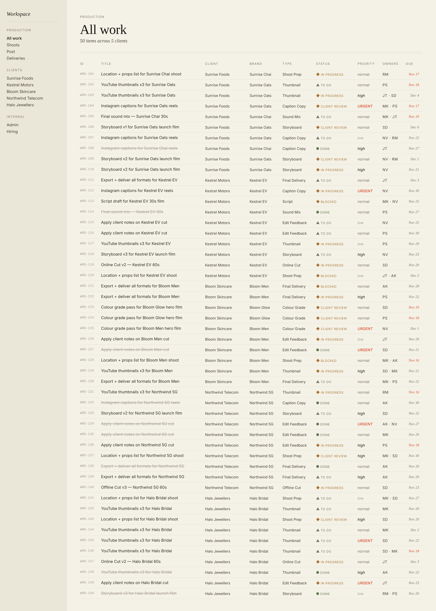

# Frontend assignment: "What do I do first?"

This repo is a working copy of one screen from a production studio's work tracker: **All work**, a list of 50 jobs across 5 clients. Every item has the same visual weight, so the late and blocked work hides among the rest.



All names, clients and brands in this repo are made up.

## Your task

**1. Decide what matters (in your notes).** Write down the 3 questions a person opening this screen at 10 am most wants answered.

**2. Redesign the screen so each of those questions can be answered in under 5 seconds.** You may remove, group, hide behind a click, or reorder anything. You may not drop information the person needs.

**3. Build it here.** Change this page in place: HTML/CSS/JS, or move it to React or any framework you like. It must:

- work on a laptop screen and a phone screen, in light and dark themes
- read the real data from `data/` (filters must work on the data, not on a hard-coded mockup)
- show three states: normal, empty (no data), and overloaded (5x the normal data)

**Time:** about 5 hours in total. Take up to 5 days.

**AI tools are allowed.** Add a short note on how you used them.

## Run it

No install needed. From this folder:

```bash
python3 -m http.server 8000
# or: npx serve .
```

Then open http://localhost:8000. (Opening `index.html` directly won't load the data, because browsers block `fetch` from `file://`.)

## The data

- `data/work-items.json`: `today` (treat this as the current date) and the 50 `items`. Each has `id`, `title`, `client`, `brand`, `type`, `status` (`todo`, `in_progress`, `client_review`, `blocked`, `done`), `priority` (`low`, `normal`, `high`, `urgent`), `owners` (initials) and `due` (YYYY-MM-DD).
- `data/people-and-clients.json`: who the initials belong to, and each client's brands.

You may add fields if your design needs them; say which and why.

## How to submit

1. Click **Use this template** (or fork) to make your own copy, and work there. Please don't open pull requests against this repo.
2. Commit as you go: we read your commit history to see how the design changed.
3. Deploy it (Vercel, Netlify or GitHub Pages) and send us:
   - the link to your repo
   - the live link
   - a short note (max 1 page): your 3 questions, and what you removed, grouped and moved, and why.

## What we look at

- **Clarity and hierarchy:** the 3 questions are answerable at a glance; late work is obvious without reading.
- **What you cut or grouped, and why:** clear reasons tied to what the person needs.
- **Built page quality:** the live link works on phone and laptop, with real data and both themes.
- **States and real data:** empty and overloaded states handled well.
- **Consistency:** the same spacing, type sizes and colours throughout.
